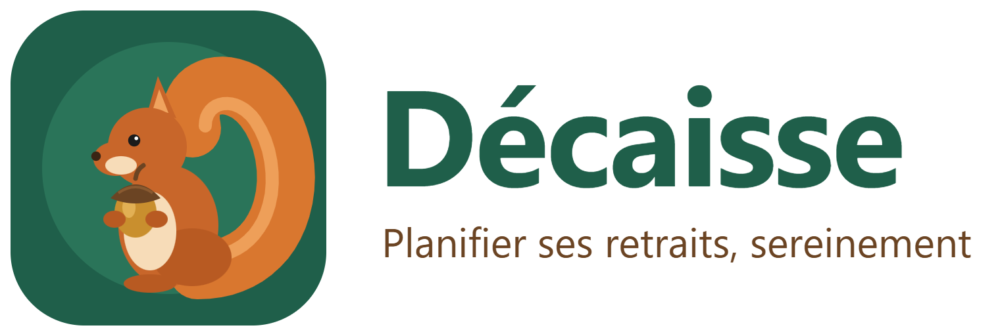

# Décaisse

**Planifier ses retraits, sereinement.** Décaisse estime, année par année, les revenus de votre retraite
(rentes, RRQ, PSV, retraits REER/FERR et CELI) et les impôts qui en découlent, et cherche le meilleur rythme
de retrait pour une personne seule ou un couple résidant au Québec (revenus de France facultatifs).

- **Télécharger l'application** : onglet [Releases](https://github.com/pfaye0366/Decaisse/releases/latest).
  Elle ne s'active qu'avec le courriel et le code d'activation reçus par invitation.
- **Guide de l'abonné** (installation, utilisation, sources) : https://pfaye0366.github.io/Decaisse/guide/
- `publication.json` : paramètres officiels (barèmes, cotisations, RRQ, PSV…) lus par l'application au
  démarrage. Ce fichier est signé ; il ne contient aucun courriel ni aucune donnée personnelle.

Vos simulations restent uniquement sur votre ordinateur : elles ne sont jamais envoyées ailleurs.

## Avertissement

Cette application produit une **estimation** d'un plan de décaissement à la retraite pour une personne ou un couple résidant au Québec (impôts fédéral, du Québec et, le cas échéant, français). Les résultats dépendent des hypothèses que vous saisissez et de règles qui comportent des simplifications.

Elle ne constitue **pas un conseil financier, fiscal ou juridique**. Ne prenez aucune décision importante sur la seule foi de ces résultats (date de retraite, début des rentes, retraits REER/FERR…) sans en avoir d'abord discuté avec votre planificateur financier.

Voyez plutôt cette simulation comme un **outil de préparation** : elle vous aide à comprendre votre situation, à explorer différents scénarios et à aborder vos rencontres avec votre planificateur de façon plus éclairée, avec les bonnes questions.
